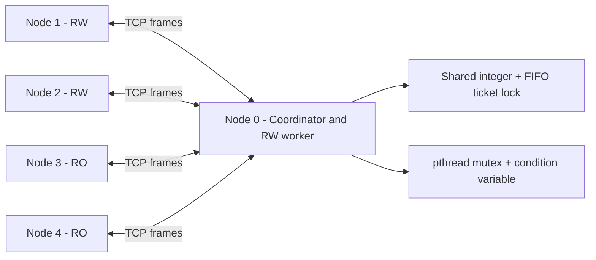

# Distributed Coordination Service

**A coordinator-based distributed system written in C**, in which independent processes read and update shared state over TCP. A central coordinator manages a single shared integer and grants mutually exclusive access using a FIFO ticket lock.

Developed as a university Distributed Systems assignment. The implementation uses **POSIX sockets and pthreads**; Python tools are included only for orchestration, automated testing, log validation, and benchmarking.

> **Scope:** This repository implements **centralized coordination**, not Ricart–Agrawala or Lamport-clock-based decentralized mutual exclusion. It is an educational prototype, not a fault-tolerant production service.

## Features

- Multiple independent server processes communicating exclusively through **TCP sockets** (no shared memory between processes).
- **Custom 12-byte framed protocol**: three 32-bit integer fields (`type`, `src`, `arg`) in network byte order, with complete-read/write helpers to handle partial socket I/O.
- **Read/write operations**: `READ`/`READ_REPLY` and `UPDATE`/`UPDATE_ACK`.
- **Mutual exclusion**: `LOCK`/`GRANT`/`UNLOCK`, allocated by a **FIFO ticket mechanism**. The coordinator uses a pthread mutex and condition variable to synchronize its own threads.
- **Synchronized startup**: `READY`/`START` barrier and `DONE` completion messages.
- Configurable worker modes: **read-write (`rw`)** or **read-only (`ro`)**, selected at startup.
- Structured JSONL event logs, correctness checking, integration tests, and scalability benchmarks.

## Architecture



**Node 0** owns the shared integer and is also a worker. A separate thread handles each remote node; the coordinator uses a mutex/condition variable to protect local shared state. Other nodes issue requests and await their responses over TCP. Within a critical section, a read-write node performs **read → increment → update** before releasing the lock. The `sleep` interval is outside the critical section.

### Protocol

| Request/message | Reply | Purpose |
| --- | --- | --- |
| `READY` | `START` | Startup synchronization barrier |
| `LOCK` | `GRANT` | Enter the critical section |
| `READ` | `READ_REPLY(value)` | Read the latest shared value |
| `UPDATE(value)` | `UPDATE_ACK` | Replace the shared value |
| `UNLOCK` | — | Release the critical section |
| `DONE` | — | Signal process completion |

Control frames do not carry the shared value or identify whether a node is `rw` or `ro`.

## Requirements

- Linux or WSL2 with **GCC**, **GNU Make**, and **POSIX pthreads**.
- **Python 3** for test runners and log analysis; no Python packages are needed for the basic test/validation commands.
- **Matplotlib** is optional and needed only to generate plots (`analysis.py plot`, `plot-benchmark`, or `diagrams.py`).

On Ubuntu/WSL, dependencies can be installed with:

```bash
sudo apt update
sudo apt install -y build-essential python3
# Optional for plots:
sudo apt install -y python3-matplotlib
```

## Build and quick start

Compile from the repository root:

```bash
make
```

**Recommended: automatic five-node demo** (3 readers/writers, 2 readers):

```bash
python3 herramientas/run_cluster.py -n 5 --rw 3 --sleep 0 --iterations 10
```

The runner starts five separate `./server` processes, collects their logs, and validates the execution. With an initial value of zero and ten increments from each of the three `rw` nodes, the **expected final value is 30**.

### Manual run: five terminals

Open five terminals in the repository root, execute one command in each, then press **Enter in all five terminals**. Once the nodes are ready, the coordinator broadcasts `START` and processing begins.

| Terminal | Command |
| --- | --- |
| 1 (coordinator) | `./server --id 0 --mode rw --n 5` |
| 2 | `./server --id 1 --mode rw --n 5` |
| 3 | `./server --id 2 --mode rw --n 5` |
| 4 | `./server --id 3 --mode ro --n 5` |
| 5 | `./server --id 4 --mode ro --n 5` |

Each node runs ten iterations by default, sleeping one second after each iteration. The coordinator reports a **final value of 30**, regardless of which node accesses the shared variable first.

### Command-line options

```text
./server --id ID --mode rw|ro --n N [--ip 127.0.0.1] [--port 5000]
         [--sleep 1] [--iterations 10] [--no-wait] [--log-dir logs]
```

- `--id`: unique node ID (`0` is coordinator); `--n`: total number of nodes.
- `--mode`: `rw` or `ro`, fixed during the execution.
- `--ip` / `--port`: coordinator address and TCP port (default localhost:5000).
- `--sleep`: seconds between iterations (default 1).
- `--iterations`: operations per node (default 10).
- `--no-wait`: skip manual Enter prompt, for test runs.
- `--log-dir`: output directory for `node_<id>.jsonl` files.

## Testing and validation

**The test commands below serve different purposes:** `make test` covers only the C protocol tests, whereas the Python scripts exercise real server processes and validate logged histories.

```bash
# Compile and run C framing/socket protocol tests
make test

# Integration tests using real server processes (8 unittest cases)
python3 herramientas/test_cluster.py

# Tests of the Python history validator (12 unittest cases)
python3 herramientas/test_analysis.py

# Run a cluster and inspect its JSONL logs
python3 herramientas/run_cluster.py -n 5 --rw 3 --sleep 0 --iterations 10
python3 herramientas/analysis.py validate logs/run
```

The validator checks successful completion, the expected final value, iteration counts, the structure of critical sections, **no overlapping critical sections**, **no stale reads**, and **no lost increments**. These are checks on recorded executions, not a formal proof for all possible executions.

### Benchmarking and visualization

```bash
# Execute repeated scalability benchmarks (creates JSON and per-run logs)
python3 herramientas/analysis.py benchmark --ns 2,4,8,16,24,32 --sleep 0 --reps 5 --out figs/bench

# Optional: requires matplotlib; creates PNG plots
python3 herramientas/analysis.py plot-benchmark figs/bench

# Plot a previously completed demo
python3 herramientas/analysis.py plot logs/run --out figs/run
```

The university report tested up to **32 processes**, with five repetitions per configuration. In the reported **saturated local WSL2 benchmark** (`sleep=0`), waiting time increased as more nodes contended for the centralized lock:

| Processes | Mean lock wait | Critical sections/second |
| ---: | ---: | ---: |
| 2 | 0.17 ms | 4,766 |
| 8 | 3.11 ms | 2,222 |
| 16 | 9.74 ms | 1,525 |
| 32 | 31.49 ms | 973 |

These measurements describe **one-machine local runs**, not cross-network performance guarantees. The centralized lock reduces throughput under contention.

## Repository layout

```text
.
├── server.c                  # Server/client processes and coordinator
├── protocol.c                # TCP protocol and socket helpers
├── protocol.h
├── Makefile
├── tests/
│   └── test_protocol.c       # C-level protocol tests
├── herramientas/             # Python 3 support tools (not core system)
│   ├── run_cluster.py        # Multi-process runner
│   ├── test_cluster.py       # Integration tests
│   ├── test_analysis.py      # Validator tests
│   ├── analysis.py           # Log validation, metrics, benchmarks, plots
│   └── diagrams.py           # Figures for the university report
├── .gitignore
└── README.md
```

## Known limitations

- **Single point of failure:** the coordinator owns the shared value and lock; there is no coordinator failover or persistent state.
- **No recovery from failures:** closed connections during execution cause the run to abort; stalled connections may cause indefinite waits.
- **Central bottleneck:** all reads and writes are serialized, including concurrent read-only operations.
- **Fixed membership:** the number of nodes is chosen before startup; joining during execution is not implemented.
- **No authentication or encryption:** intended for trusted/controlled environments, not untrusted networks.
- **Validation scope:** tests and timestamp-based log analysis were carried out on one machine; cross-host ordering is not established by these timestamps.

## Technologies

**C11 · POSIX Sockets · TCP/IP · pthreads · Concurrency · Distributed Systems · Python 3 · GCC · Make**
